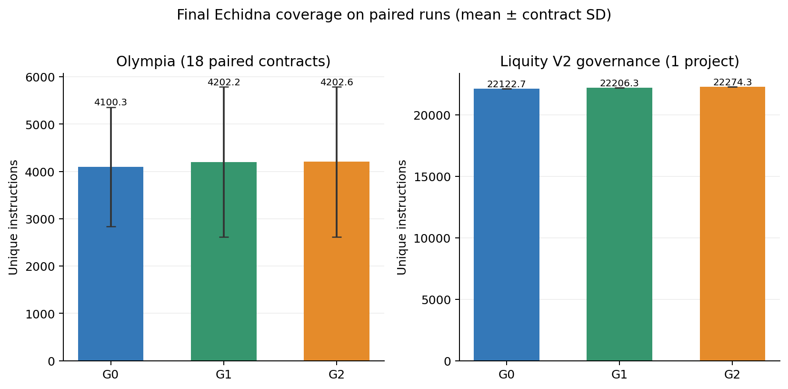
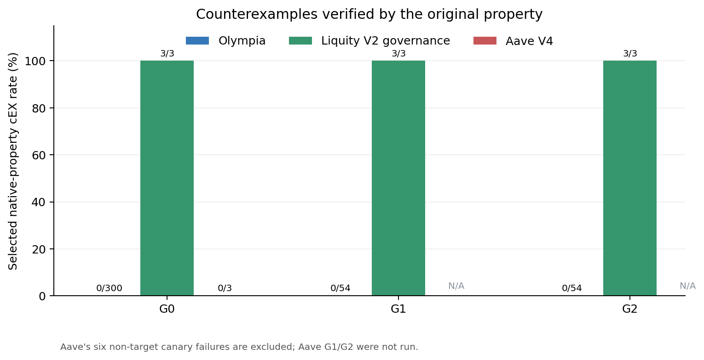
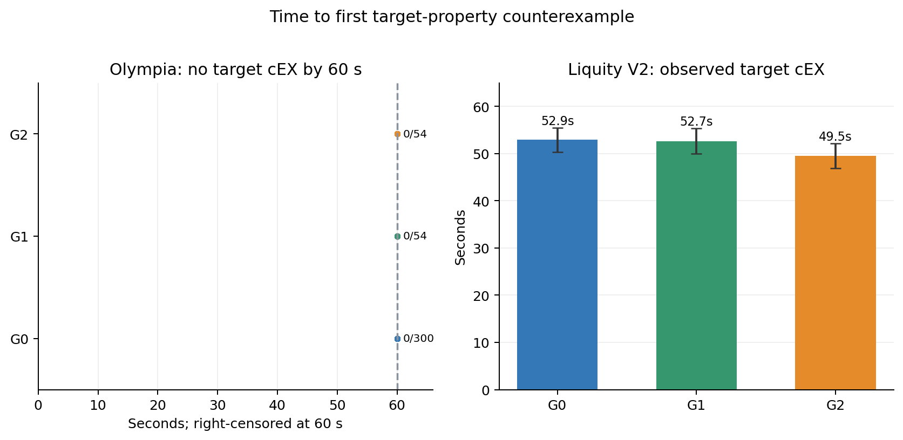
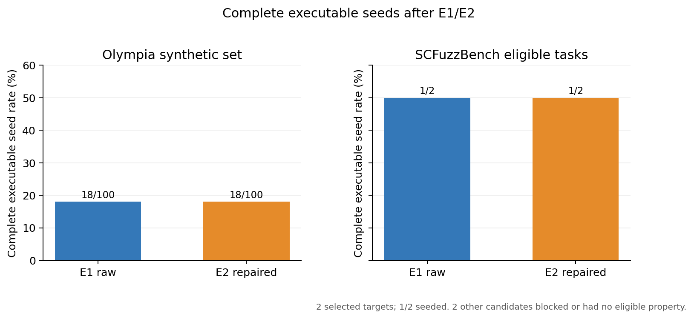
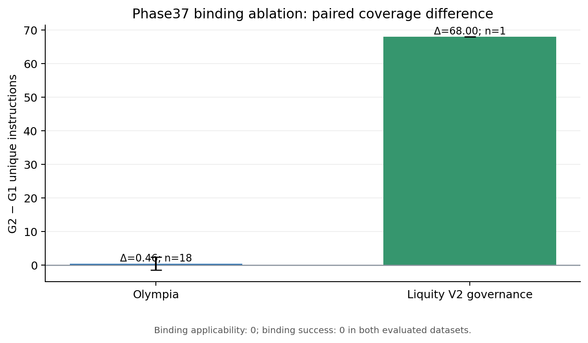

# Phase43：大规模公开基准实验

执行日期：2026-11-23 至 2026-11-24。实验基线：请求给定的 `93e2ed28d0c3d84b8a57f07c931bfcb84e2a0692`；正式结果在隔离 worktree 中产生。

## 结论摘要

- **V2 是否有效：**Olympia 上 18/100 个任务产生完整可执行 Agent 序列，但 408 次正式 G0/G1/G2 fuzz 中没有发现原生属性反例。注入种子后的配对覆盖有小幅提高；目前没有证据证明 V2 提高了合成基准的反例发现能力。
- **E2 是否有收益：**没有观察到收益。Olympia E1、E2 都是 18/100 个完整序列；7 个部分/失败回放的 E2 修复均未应用，0/7 修复成功。真实项目 Liquity 的 E2 序列与 E1 完全相同，且不需要修复。
- **G2 是否优于 G1：**没有可归因于绑定的优势。Olympia 的 G2 配对最终覆盖只比 G1 多 0.46 条 unique instruction；Liquity 多 68 条。两项数据中 Phase37 绑定均适用 0 次、成功 0 次，且没有 G1/G2 扩展候选。
- **Echidna 最终覆盖是否改善：**有小幅配对覆盖信号。Olympia 的 18 个可配对样本上，G1/G2 比 G0 平均高 2.5%；Liquity 单项目上分别高 0.38% 和 0.69%。这不等价于漏洞发现提升，真实项目只有一个目标任务。
- **真实项目泛化证据是否成立：**尚未成立。四个冻结候选中，Aave 与 Liquity 进入原生属性 fuzz；只有 Liquity 产生 V2 种子。Liquity 的 G0、G1、G2 均为 3/3 发现目标反例，E1/E2 seed-only 均未发现反例。另两个项目因固定源码/属性准入条件未进入实验。

## 冻结数据与执行设置

Olympia 固定上游 commit `325b910388416750d3485c7b588aba4411971c2d`，官方 wrapper SHA-256 为 `e68a01b7e51450bf35645a323a4c0e01a5fceadf2225221ab6ec39e7e0aa2bb6`。按官方可重复生成方式，以随机种子 `20261123` 生成 100 个样本，维度 5/10/15/20 各 25 个。100 个项目均编译并通过生成器可达性检查。20 个预检样本（每档 5 个）全部完成。冻结 manifest 记录每个样本及源文件哈希；生成器答案、`sol_tx`、`sln` 保留在数据集中，未提供给 Agent。

真实项目沿用 SCFuzzBench commit `078af185f3fa416cc13edfe3678f94c01a38d561` 和冻结 `targets.json`（SHA-256 `24ff28c830de8c2444760031c5c554b9e129c0adaa205d4eb0a92cfd5acacdb3`）。Drips 只作开发回归，不进入独立结果。所有任务固定序列长度上限 8、G1/G2 各最多 24 个扩展候选回放、单属性 Agent A/B 各至多调用一次；G0/G1/G2 使用配对随机种子 4301、4302、4303，Echidna 单 worker，每次 60 秒。每次任务独立 corpus。算法冻结；唯一代码改动是通用动态整数数组 ABI/语料编码及执行适配兼容，不为单个迷宫增加策略，也未改上游业务源码、属性或 Harness 语义。

## Olympia 合成状态依赖基准

### 序列、修复与目标状态

| 维度 | E1 完整可执行 | E1 部分/失败 | 无完整候选 | 完整序列率 |
|---:|---:|---:|---:|---:|
| 5 | 2/25 | 2/25 | 21/25 | 8% |
| 10 | 4/25 | 1/25 | 20/25 | 16% |
| 15 | 7/25 | 0/25 | 18/25 | 28% |
| 20 | 5/25 | 4/25 | 16/25 | 20% |
| 合计 | 18/100 | 7/100 | 75/100 | 18% |

E1 与 E2 的完整序列数相同。E2 对 7 个发生外层回滚的部分序列执行约束修复检查，均因没有证据支持的 guard/数值修复而保持原序列；修复种类为“无”，0/7 成功。18 个原本完整的序列无需修复。75 个没有具体 Agent 序列的任务未进入 E2 回放。

完整 E1/E2 seed-only 各 18/100，均未发现 `Maze.echidna_noBug()` 反例。回放反馈中的目标状态不可观测任务记为 `unknown`，没有按属性通过推断为已到达或未到达。G1/G2 在 25 个有 Agent 回放结果的任务上执行扩展阶段，但没有产生可回放候选；其余 75 项未运行扩展。形式 fuzz 只对 18 个有可加载 E2 种子的样本运行 G1/G2，分别完成 54 次；G0 对 100 个样本完成 300 次。G1/G2 的扩展构造器将动态数组参数 `int8[]` 判为没有安全默认值，因此扩展候选数和候选回放数均为 0；通用 ABI 支持只让原始 Agent 序列可编码、执行和转换成 Echidna 语料，不会自动合成数组策略。

原生属性反例为 G0 0/300、G1 0/54、G2 0/54。全部未发现任务按 60 秒预算右删失，首次反例时间记为“未观察到”，不填 0 秒。实验中出现的编译器安装/路径、Agent 输出和 7 个 E2 回滚均保留在 `failures.csv` 和逐任务原始记录。

### 覆盖配对结果

仅使用 18 个同时完成 G0/G1/G2 且每组各有三个随机种子的样本进行配对比较。覆盖单位是同一 Olympia 工具链统计的 unique instructions。

| 组别 | 配对样本数 | 平均最终覆盖 | 相对 G0 |
|---|---:|---:|---:|
| G0 | 18 | 4100.26 | — |
| G1 | 18 | 4202.17 | +101.91（+2.49%） |
| G2 | 18 | 4202.63 | +102.37（+2.50%） |

G2 相对 G1 只增加 0.46 条指令。G1/G2 都没有扩展候选，Phase37 绑定适用次数和成功次数均为 0；该微小差异不能解释为绑定带来的因果收益。

## SCFuzzBench 真实项目独立验证

每个候选均保留在 104 项 admission 清单中。对多属性合约，按冻结的目标任务筛选流程选取符合研究目标的原生 Boolean 属性；未符合条件时不替换目标。

| 项目 | 固定项目 commit | 准入与属性任务 | V2 / 原生结果 |
|---|---|---|---|
| Aave V4 | `6f9795808367de1357c1059377dde9201b9c1d66` | Solc 0.8.28 构建通过；直接 Solc 分析 9 个原生 Boolean 属性；选择 `invariant_shouldNotBecomeLiquidatable()`。 | Agent A 一次调用未生成具体序列，Agent B 未调用。G0 目标属性 0/3 反例，三次均 passing；两项非目标 canary 每次失败，单列记录，不计目标反例。G1/G2 因无 V2 种子记 N/A。 |
| Liquity V2 Governance | `5610870e7e91fe6e29f8cfb0c0ae316fe9784e10` | Solc 0.8.24 构建通过；分析 7 个 Boolean 属性；选择 `invariant_GV01()`。 | E1/E2 各 1 条完整交易；seed-only 均加载并重放，属性通过、无反例。E2 与 E1 字节相同。G1/G2 扩展候选为 0。G0/G1/G2 正式 fuzz 均 3/3 经原生 `invariant_GV01()` 核实反例。 |
| Superform v2-periphery | `102eeaf5e2f49963bdd007c7358739b0a0e59e84` | 冻结提交未能按预期完整检出，工作树解析到另一个 commit；构建缺少固定子模块中的 OpenZeppelin `IERC20Metadata.sol`。 | 原生分析、属性运行、Agent 和 fuzz 均未运行，记 N/A；未替换源码版本或删除样本。 |
| Origin Dollar | `299ec6b6bf5401b43efc3e9f7ee5cab3e76167c4` | Solc 0.8.28 构建通过；属性入口为参数化 `test`/assert 函数，没有符合冻结条件的零参 Boolean 原生属性。 | 不创建替代任务；Agent、原生属性 fuzz、V2 与覆盖结果均为 N/A。 |

### Liquity 正式 fuzz 与 G1/G2 对照

| 组别 | 目标反例 | 平均首次发现 | 平均 seed-only 覆盖 | 平均最终覆盖 | 平均新增覆盖 |
|---|---:|---:|---:|---:|---:|
| G0 | 3/3 | 52.92 秒 | — | 22122.67 | — |
| G1 | 3/3 | 52.67 秒 | 7966 | 22206.33 | 14240.33 |
| G2 | 3/3 | 49.51 秒 | 7966 | 22274.33 | 14308.33 |

G1/G2 都从同一条 E2 seed-only 基线开始，目标反例是在正式 fuzz 中发现，而不是 seed-only 直接违反属性。G0 也在相同 60 秒预算内 3/3 找到目标反例，因此结果没有证明 V2 提高了本项目的发现率。G2 比 G1 平均多 68 条指令，首次发现平均快约 3.16 秒，但绑定适用/成功均为 0；该差值是单项目、三个随机种子的 fuzz 变化，不能归因于 Phase37 绑定。

Foundry 生成驱动的直接 replay 与原生 Echidna seed-only 的属性结果不一致；该 Foundry 结果保留为 backend mismatch，不作为反例，也不覆盖原生属性证据。Echidna 原生结果是本报告唯一用于反例计数的 Oracle。

### 真实项目泛化边界

四个独立候选中，2 个进入可执行原生属性 fuzz；1 个产生完整 V2 种子。按全部四个候选计，E1/E2 完整序列均为 1/4；按两个已选取原生属性且可执行的任务计为 1/2。Liquity 的目标反例在 G0 也同样出现，且 E2 seed-only 没有直接发现，因此本阶段只能说明真实项目执行和覆盖链路可用，不能声称 V2 的真实项目反例发现优势或跨项目泛化。

## 端到端成本与原始产物

| 口径 | 实际记录 |
|---|---:|
| Olympia 单样本流水 `elapsed_seconds` 求和 | 31,458.12 秒（100 个样本；约 8.74 小时累计任务时间，不代表跨任务日历墙钟） |
| Olympia 分析与编译准备合并计时 | 4,965.84 秒；原 runner 未将静态分析和准备编译分开计时 |
| Olympia E1/E2 本地执行回放 | E1 12.35 秒、E2 9.90 秒累计；修复阶段本身没有单独计时器 |
| 正式 fuzz | Olympia G0/G1/G2 共 408 次，预算每次 60 秒；CSV 分列 Echidna compile、扣除 compile 后的 fuzz active time 与 run wall |
| SCFuzzBench 正式 fuzz | 12 次最终运行；另列每次的 static analysis、compile、fuzz 和 wall 时间 |
| Agent API 请求耗时 | 203 次请求累计 435.573 秒；Olympia 200 次/425.715 秒，真实项目 3 次/9.858 秒 |
| Agent token 与估算费用 | 1,602,673 tokens；off-peak 估算 `$0.249516942`、peak 估算 `$0.499033884`。这是按响应 usage 与记录价目计算的估算，不是供应商账单。 |

Olympia Agent 成本只在每个任务的一行记录，未在 G1/G2 fuzz 行重复计入。所有阶段数据见 `campaign-results.csv`、`metrics-summary.csv` 与 `agent-cost-summary.csv`。准备、失败尝试、Echidna compile、fuzz 与 Agent 调用均有独立日志或字段；没有覆盖全生命周期的单一墙钟计时器，因此报告逐阶段累计，不把遗漏的准备时间估成精确端到端墙钟。

完整冻结记录、逐任务原始数据及可续跑状态位于 [`Phase43-20261123`](../func/测试过程/跨交易属性状态依赖审计/结果/Phase43-20261123/)：

- `dataset-manifest.json`：104 个目标来源、commit、hash、分组、运行和阻塞状态。
- `admission.csv`：104 行完整准入记录。
- `campaign-results.csv`：Olympia 100 项与 SCFuzzBench 4 项，合计 1,768 行，含 N/A、三随机种子和阶段耗时。
- `metrics-summary.csv`：按数据源、难度、组别和阶段汇总。
- `failures.csv`：196 条逐阶段失败、阻塞、修复失败和非目标 Canary 记录。
- `agent-cost-summary.csv`：每个目标一行的 Agent 调用、token、估算费用及请求时间。
- 原生 Echidna 日志、语料种子、执行反馈、LCOV、Agent 请求/响应记录和 campaign JSON。
- 100 份大型属性分析报告以 gzip 无损副本入库；原始文件保留在本机，SHA-256 与恢复校验见 `analysis-archive-manifest.json`。Aave 大型 Slither 报告和日志采用相同方式。

## 阶段判定

Phase43 完成了冻结的 100 个 Olympia 样本与四个真实项目候选的批量执行，没有因结果替换样本、修改算法或删除准入失败项目。V2 在 Olympia 上的有效序列率为 18%，但没有原生反例；E2 没有提升；G2 的 binding 没有适用机会；Echidna 覆盖有幅度有限的正向变化。真实证据局限于 Liquity 一个目标属性，且 G0 同样发现了反例。当前结论为：**覆盖接入有初步正向信号，V2 的独立反例发现收益与真实项目泛化仍未证实。**
